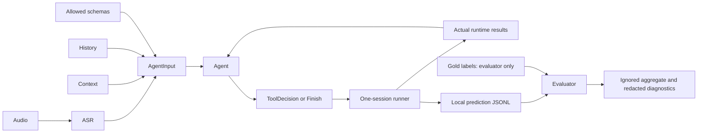

# Architecture

## Responsibilities and boundaries

| Module | Responsibility | Information available |
| --- | --- | --- |
| `asr/base.py` | ASR Protocol for authorized audio | Audio path; no labels |
| `agent/base.py` | AgentInput, ToolDecision, Finish, Agent Protocol | Current transcript, context, history, allowed schemas, actual previous results |
| `tools/catalog.py` | Catalog inventory, allowlist and static validation | Tool schemas and installed tools; documented system exception |
| `tools/env_runner.py` | Single-use environment creation, replay and future live loop | Input calls and runtime results; snapshots only for offline replay |
| `evaluation/dataset.py` | Existing manifest validation, train streaming, prediction parsing, input builder | Evaluator-only records; produces sanitized independent AgentInput |
| `evaluation/traces.py` | JSON-exact equality, name alignment and argument counts | Gold/predicted calls; never used to plan |
| `evaluation/taxonomy.py` | Deterministic overlapping error labels and precedence | Observable comparison/runtime diagnostics |
| `evaluation/stratification.py` | Gold/input-derived groups | Gold features and training-partition frequencies; evaluator only |
| `evaluation/metrics.py` | Aggregate metrics, denominators and intervals | Redacted comparison counts |
| `evaluation/execution.py` | Evaluator-only state/result comparison | Private in-memory observations and gold changed-app labels |
| `evaluation/reporting.py` | JSON/CSV/Markdown artifacts | Safe diagnostic counts; raw predicted calls only by explicit flag |
| `evaluation/benchmark.py` | CLI, provenance and orchestration | Evaluator inputs, modes and settings |
| `utils/language.py` | Unchanged EDA regexes | Text in-memory; boolean outputs |
| `utils/json.py`, `utils/safety.py` | JSON type semantics, restricted-path checks and scoped audit guard | No dataset scan or direct state access |
| `exploration.py` | Preserved EDA pipeline with adapted roots/default outputs | Local EDA inputs under its separate original restrictions |

Prediction generation is separate from evaluation. A future adapter receives `build_agent_input(record, catalog)` and does not receive the evaluator record, dataset loader, gold trace or current gold results. The builder allowlists fields and deep-copies mutable values. Historical assistant actions/results remain usable context because they occurred before the scored request.

## Runtime and leakage protections

`EnvRunner` claims a sample ID before construction and refuses another attempt in the same runner, including constructor failures. It invokes ToolEnv through a private train-package import, never `Executor` or `load_environment`. No direct state-file open exists in evaluator code. The benchmark audit hook rejects public-test reads and direct environment access; only the official constructor receives a scoped environment-read capability. State snapshots remain offline evaluator memory and never enter the live-agent loop or reports.

The guard prevents accidental access within this code path; it is not a security sandbox for untrusted Python model code. Run independent prediction generation without evaluator objects when stronger process isolation is needed. In a future live integration, one runner must own the sample for the entire prediction run; do not replay its generated calls again inside that same run.

## Packaging and EDA migration

The package uses `src/` and standard-library core dependencies. Checkout entrypoints explicitly add the local `src` directory; installed entrypoints use pyproject console scripts. The old EDA script/tests are copied and adapted, not moved. `README_DATA.md` is accepted after the dataset folder rename, and new EDA defaults write to artifacts. The original source/report/manifests are preserved for comparison. No confidential EDA statistics or manifests are bundled with the code.
