# LifeMate Dataset Exploration

Offline analysis of the local competition release. All measured findings below come from the executed pipeline. No ASR model, LLM, ToolEnv, history replay, or gold execution was run. Public-test observations are isolated as an unlabeled distribution audit.

## 1. Executive Summary

- The training JSONL contains **1,545 records**, **1,545 unique IDs**, and **3,541 gold calls** across **146 observed tools**. The catalog contains **46 apps / 147 tools**.
- **1,065 samples (68.93%)** require multiple calls; **791 (51.20%)** use multiple apps including sys, or **715 (46.28%)** excluding sys. Maximum trajectory length is **6** calls.
- **1,018 (65.89%)** contain history; the final-request reference-marker heuristic matches **608 (39.35%)**.
- Referenced training audio totals **6.829 hours** over **5,036 unique paths**. Current-request median / p95 duration is **6.936 / 11.836 seconds**.
- Gold trajectories contain **617 samples** with an x-ref argument exactly matching an earlier returned string. This is heuristic evidence for runtime entity resolution, not proof of causal reliance.
- **217 gold calls** are absent from explicit installed lists, but static runtime-source inspection confirms the always-available system-tool exception. There are **0 genuine permission discrepancies** after applying it.
- The immediate engineering priority is a training-only evaluation harness, schema/availability enforcement, and a result-aware agent loop. Benchmark ASR on execution-sensitive entities and time expressions; this exploration provides no ASR performance evidence.

## 2. Dataset Description

The root was discovered from the requested directory or its ancestors by requiring README.md and train/train.jsonl. The authoritative source is [README](../README.md). Package metadata:

```text
release: v3.2.0
built: 2026-10-24T23:35:25+0700
train 1545 / public_test 634
```

The observed top-level layout matches the README: train and public_test each contain a JSONL, a tool catalog, audio, a split environment directory, and zaic_tools. The documented private_test is a future release and is absent. The public split also has sample_submission.jsonl. Environment directories were not used by the analysis.

Current audio_text is a string, not a list or token object. context contains current_time, timezone, location, user_profile and installed_apps. History is a list of role-tagged user/assistant turns. Gold calls are objects with name and arguments; results align by list index. final_state maps changed app IDs to full app states: only its app keys were inspected.

Only the final user request is scored. **History actions are already applied to the initial state and must not be replayed.** At inference, each sample permits a single independent ToolEnv instance; all calls, including rejected calls, count. Source environment state must be accessed through the official interface only. No environment access was needed here.

The README prohibits sharing/distributing the package. All processing stayed local; no dataset content was uploaded, committed, or sent to a model. Derived artifacts contain aggregate measurements, catalog schemas, and sample IDs/feature counts; they remain competition-confidential.

## 3. Data Quality and Integrity

| check | count | percent |
| --- | --- | --- |
| Parsed training records | 1545 | 100.000 |
| Unique IDs | 1545 | 100.000 |
| Duplicate ID excess rows | 0 | 0.000 |
| Nonempty histories | 1018 | 65.890 |
| Empty histories | 527 | 34.110 |
| Multiple installed apps | 1545 | 100.000 |
| Static schema error calls | 0 | 0.000 |

Nonzero integrity counters:

None detected by implemented checks.

Percentages above use samples, except static schema errors, which use calls. Issue counters containing “calls” or “occurrences” can exceed a sample count. Full anomaly/observation IDs are in tables/integrity_issues.csv; type paths and sample prevalence are in tables/field_types.csv. Empty history, zero tool calls, empty final_state, absent optional assistant calls/results, and optional catalog arguments are legitimate. Missing documented top-level or gold-label fields, wrong types, unresolved WAV references, unknown catalogs, and unpermitted gold calls are treated as anomalies. Static validation checks top-level required/type/enum/minimum/maximum and explicitly forbidden extra arguments; it does not certify x-one-of, nested schemas, cross-app references, fuzzy matching, or runtime behavior.

### Explicit integrity check totals

| check | anomaly_count | denominator | percent |
| --- | --- | --- | --- |
| malformed_json_lines | 0 | 1545 | 0.000 |
| nonobject_records | 0 | 1545 | 0.000 |
| call_result_length_mismatch | 0 | 1545 | 0.000 |
| unknown_available_tool_occurrences | 0 | 50255 | 0.000 |
| unknown_gold_tool_calls | 0 | 3541 | 0.000 |
| gold_tool_not_permitted_calls | 0 | 3541 | 0.000 |
| missing_id | 0 | 1545 | 0.000 |
| wrong_type_id | 0 | 1545 | 0.000 |
| missing_audio | 0 | 1545 | 0.000 |
| wrong_type_audio | 0 | 1545 | 0.000 |
| missing_context | 0 | 1545 | 0.000 |
| wrong_type_context | 0 | 1545 | 0.000 |
| missing_history | 0 | 1545 | 0.000 |
| wrong_type_history | 0 | 1545 | 0.000 |
| missing_audio_text | 0 | 1545 | 0.000 |
| wrong_type_audio_text | 0 | 1545 | 0.000 |
| missing_label | 0 | 1545 | 0.000 |
| wrong_type_label | 0 | 1545 | 0.000 |
| label_missing_tool_calls | 0 | 1545 | 0.000 |
| label_wrong_type_tool_calls | 0 | 1545 | 0.000 |
| label_missing_tool_results | 0 | 1545 | 0.000 |
| label_wrong_type_tool_results | 0 | 1545 | 0.000 |
| label_missing_final_state | 0 | 1545 | 0.000 |
| label_wrong_type_final_state | 0 | 1545 | 0.000 |

### Explicit-list discrepancy resolved by runtime documentation

217 gold calls (6.128% of calls) are absent from the explicit context tool lists: `{"sys.ask_missing_info": 217}`. The main README describes only installed tools, but [zaic_tools README](../train/zaic_tools/README.md) explicitly documents sys.ask_missing_info as always available; [executor.py](../train/zaic_tools/executor.py) unions it into self.allowed and creates the system app. The pipeline reads and parses that source syntax without importing or running it. This is a documentation clarification and legitimate meta behavior, not mislabeled training data. Effective availability includes the observed runtime system exceptions `['sys.ask_missing_info']`. No environment metadata was read to verify actual per-sample _meta.tools; permission checks compare the JSONL allowlists plus these source-defined exceptions.

## 4. Audio and Language Characteristics

### Audio measurements

| measure | n | min | mean | median | std_population | p90 | p95 | p99 | max |
| --- | --- | --- | --- | --- | --- | --- | --- | --- | --- |
| current WAV duration (seconds) | 1545 | 1.743 | 7.227 | 6.936 | 2.664 | 10.630 | 11.836 | 15.057 | 22.334 |
| historical WAV duration (seconds) | 3491 | 0.986 | 3.844 | 3.531 | 1.483 | 5.593 | 6.560 | 9.300 | 17.087 |
| all unique WAV duration (seconds) | 5036 | 0.986 | 4.882 | 4.109 | 2.477 | 8.341 | 9.857 | 13.181 | 22.334 |

Current audio contributes 3.102 hours and historical references 3.728 hours (reference-weighted); unique-path total is 6.829 hours. Standard deviations use population normalization, and quantiles use NumPy's default linear interpolation.

| status | sample_rate_hz | channels | bit_depth | compression | unique_files |
| --- | --- | --- | --- | --- | --- |
| ok | 16000 | 1 | 16 | NONE | 5036 |

Audio reference statuses: `{"ok": 5036}`. PCM payload byte counts were checked against WAV frame metadata, without interpreting sample amplitudes. This catches missing/truncated/corrupt WAVs but does not measure clipping, noise, accents, speakers, intelligibility, or transcript correctness. An inventory of unreferenced audio files was deliberately not attempted.

### Transcript measurements

| measure | n | min | mean | median | std_population | p90 | p95 | p99 | max |
| --- | --- | --- | --- | --- | --- | --- | --- | --- | --- |
| transcript_chars | 1545 | 12.000 | 97.320 | 96.000 | 35.026 | 144.600 | 161.000 | 189.120 | 296.000 |
| transcript_tokens | 1545 | 3.000 | 22.450 | 22.000 | 7.908 | 34.000 | 36.000 | 44.560 | 67.000 |

There are 1,544 distinct raw strings and 1,544 distinct normalized strings. Raw exact duplicates: 1 groups / 1 excess rows. Normalized duplicates: 1 groups / 1 excess rows / 2 participating samples. Normalization uses NFC, Unicode casefold, punctuation-to-space, and whitespace collapse, preserving Vietnamese diacritics. Whitespace tokens approximate syllable/orthographic units, not segmented Vietnamese words.

To prevent personal text export, common-token output is restricted to a fixed generic Vietnamese vocabulary; phrase output uses a fixed generic phrase list. Thus it is a **privacy-filtered frequency view**, not a complete vocabulary ranking. No transcript examples, names, contact values, addresses, coordinates, or arbitrary transcript n-grams are exported.

| word | occurrences |
| --- | --- |
| cho | 698 |
| rồi | 543 |
| giờ | 520 |
| nhé | 492 |
| đi | 401 |
| tôi | 385 |
| cái | 381 |
| không | 365 |
| đó | 341 |
| mai | 339 |
| giúp | 335 |
| với | 264 |
| sáng | 260 |
| hai | 250 |
| một | 246 |
| tiền | 242 |
| báo | 240 |
| đặt | 234 |
| là | 219 |
| nhắn | 213 |
| phòng | 212 |
| thôi | 203 |
| nay | 198 |
| lại | 197 |
| tối | 172 |

| phrase | samples |
| --- | --- |
| báo thức | 92 |
| giúp tôi | 78 |
| nhắc tôi | 60 |
| tối nay | 57 |
| đừng | 31 |
| tuần sau | 19 |
| lịch họp | 12 |
| lúc nãy | 12 |
| chuyển tiền | 10 |
| cái đó | 9 |
| thời tiết | 5 |
| à nhầm | 5 |
| gửi tin nhắn | 4 |
| ngày mai | 2 |

### Language indicators (overlapping sample-level regex matches)

| item | count | percent |
| --- | --- | --- |
| quantity | 845 | 54.693 |
| reference | 608 | 39.353 |
| conjunction | 577 | 37.346 |
| clock_time | 546 | 35.340 |
| relative_time | 508 | 32.880 |
| negation | 481 | 31.133 |
| contact | 368 | 23.819 |
| digit | 207 | 13.398 |
| english_indicator | 182 | 11.780 |
| date | 73 | 4.725 |
| correction | 64 | 4.142 |

The complete regex definitions are in tables/language_heuristics.csv and the script. Relative-time markers include tomorrow/tonight/next week equivalents; clock and date markers are separate. Quantity includes digit-unit expressions and common number words; this overcounts ambiguous Vietnamese words such as “năm”. Contact is a mention/intent proxy, not detected entities. Negation includes “không”, which also occurs in questions. Reference includes broad words such as “đó”, “lại”, and “tiếp”, so it cannot establish actual history dependence. English indicators combine loanwords, brands and app vocabulary; they do not measure true code-switching rates. Regexes may miss spoken variants and produce false positives. No regional-accent, gender, speaker-identity, WER, or noise claims can be made from this analysis.

## 5. Conversation and Context Characteristics

| measure | n | min | mean | median | std_population | p90 | p95 | p99 | max |
| --- | --- | --- | --- | --- | --- | --- | --- | --- | --- |
| history_turns | 1545 | 0.000 | 4.519 | 2.000 | 5.769 | 12.000 | 20.000 | 22.000 | 24.000 |
| history_user_turns | 1545 | 0.000 | 2.260 | 1.000 | 2.884 | 6.000 | 10.000 | 11.000 | 12.000 |
| history_assistant_turns | 1545 | 0.000 | 2.260 | 1.000 | 2.884 | 6.000 | 10.000 | 11.000 | 12.000 |
| history_tool_calls | 1545 | 0.000 | 2.370 | 1.000 | 3.119 | 7.000 | 10.000 | 12.000 | 16.000 |
| installed_apps | 1545 | 3.000 | 9.201 | 9.000 | 2.814 | 13.000 | 14.000 | 16.000 | 18.000 |
| available_tools | 1545 | 8.000 | 32.528 | 31.000 | 10.054 | 46.000 | 50.000 | 57.000 | 62.000 |

Historical assistant tool calls occur in 957 samples and total 3661 calls. Historical user audio_text types: `{"str": 3491}`. These histories were summarized, not executed.

| pattern | samples |
| --- | --- |
| (empty) | 527 |
| user → assistant | 288 |
| user → assistant → user → assistant | 267 |
| user → assistant → user → assistant → user → assistant | 137 |
| user → assistant → user → assistant → user → assistant → user → assistant | 81 |
| user → assistant → user → assistant → user → assistant → user → assistant → user → assistant | 76 |
| user → assistant → user → assistant → user → assistant → user → assistant → user → assistant → user → assistant → user → assistant → user → assistant → user → assistant → user → assistant | 47 |
| user → assistant → user → assistant → user → assistant → user → assistant → user → assistant → user → assistant | 41 |
| user → assistant → user → assistant → user → assistant → user → assistant → user → assistant → user → assistant → user → assistant → user → assistant → user → assistant → user → assistant → user → assistant | 35 |
| user → assistant → user → assistant → user → assistant → user → assistant → user → assistant → user → assistant → user → assistant → user → assistant → user → assistant | 33 |
| user → assistant → user → assistant → user → assistant → user → assistant → user → assistant → user → assistant → user → assistant → user → assistant → user → assistant → user → assistant → user → assistant → user → assistant | 13 |

| history_group | samples | reference_marker_samples | reference_marker_percent |
| --- | --- | --- | --- |
| with_history | 1018 | 435 | 42.731 |
| without_history | 527 | 173 | 32.827 |

### Context field availability

| item | count | percent |
| --- | --- | --- |
| current_time | 1545 | 100.000 |
| timezone | 1545 | 100.000 |
| location | 1545 | 100.000 |
| user_profile | 1545 | 100.000 |
| installed_apps | 1545 | 100.000 |

Profile fields present and nonempty (values never exported)

| item | count | percent |
| --- | --- | --- |
| name | 1545 | 100.000 |
| home_address | 1545 | 100.000 |
| work_address | 1545 | 100.000 |
| city | 1545 | 100.000 |

Location fields present and nonnull (coordinates never exported)

| item | count | percent |
| --- | --- | --- |
| lat | 1545 | 100.000 |
| lng | 1545 | 100.000 |

Timezones

| item | count | percent |
| --- | --- | --- |
| Asia/Ho_Chi_Minh | 1545 | 100.000 |

Current-time hour distribution (hour recorded in timestamp)

| item | count | percent |
| --- | --- | --- |
| 9 | 491 | 31.780 |
| 15 | 84 | 5.437 |
| 19 | 78 | 5.049 |
| 10 | 77 | 4.984 |
| 21 | 75 | 4.854 |
| 13 | 75 | 4.854 |
| 12 | 74 | 4.790 |
| 17 | 73 | 4.725 |
| 7 | 70 | 4.531 |
| 14 | 65 | 4.207 |
| 11 | 64 | 4.142 |
| 20 | 63 | 4.078 |
| 16 | 60 | 3.883 |
| 18 | 57 | 3.689 |
| 8 | 56 | 3.625 |
| 6 | 42 | 2.718 |
| 22 | 41 | 2.654 |

Current-time calendar-month distribution

| item | count | percent |
| --- | --- | --- |
| 2026-11 | 721 | 46.667 |
| 2026-10 | 421 | 27.249 |
| 2026-09 | 214 | 13.851 |
| 2026-12 | 189 | 12.233 |

### Installed app frequency (top apps; full CSV available)

| item | count | percent |
| --- | --- | --- |
| contacts | 887 | 57.411 |
| calendar | 871 | 56.375 |
| reminders | 871 | 56.375 |
| chat_ott | 691 | 44.725 |
| smart_home | 659 | 42.654 |
| weather | 634 | 41.036 |
| notes | 557 | 36.052 |
| ewallet | 549 | 35.534 |
| tasks | 543 | 35.146 |
| phone | 529 | 34.239 |
| ride_hailing | 507 | 32.816 |
| alarm | 493 | 31.909 |
| banking | 489 | 31.650 |
| food_delivery | 457 | 29.579 |
| sms | 426 | 27.573 |
| email | 368 | 23.819 |
| gold_price | 355 | 22.977 |
| music | 350 | 22.654 |
| tv | 346 | 22.395 |
| medication | 345 | 22.330 |

current_time plus timezone anchors relative dates, weekdays and time-of-day interpretation. Profile/location availability supports home/work and geographic resolution, but values should remain private. The installed-app mapping plus the runtime system-tool exception forms the execution allowlist. Prior user audio and assistant tool calls/results may resolve entities and references. Reference-marker prevalence with and without history measures linguistic association only; a useful follow-up is manual annotation and history ablation on development data.

## 6. Tool Ecosystem

| measure | value |
| --- | --- |
| schema_version | 2.7.0 |
| apps | 46 |
| tools | 147 |
| parameters | 246 |
| tools_with_ref | 65 |
| tools_with_fuzzy | 32 |
| tools_with_enum | 30 |
| tools_with_one_of | 6 |
| ref_occurrences | 68 |
| fuzzy_occurrences | 40 |
| enum_occurrences | 32 |
| one_of_occurrences | 6 |

| kind | count | percent |
| --- | --- | --- |
| write | 84 | 57.143 |
| read | 62 | 42.177 |
| meta | 1 | 0.680 |

Top-level required-argument counts:

| measure | n | min | mean | median | std_population | p90 | p95 | p99 | max |
| --- | --- | --- | --- | --- | --- | --- | --- | --- | --- |
| required per catalog tool | 147 | 0.000 | 1.020 | 1.000 | 0.907 | 2.000 | 3.000 | 3.000 | 3.000 |

The complete tool inventory includes app/group/kind/description, required and optional arguments, types, enums, x-ref, fuzzy matching, x-one-of and all additional schema constraints. Parameter-level schemas are in tables/catalog_parameters.csv. tools_with_* counts count tools containing a constraint; *_occurrences counts nested schema occurrences.

### Schema-heavy tool examples

| tool | parameter_count | required_count | ref_count | enum_count | fuzzy_count | one_of_count |
| --- | --- | --- | --- | --- | --- | --- |
| banking.transfer | 4 | 3 | 2 | 0 | 1 | 0 |
| home_automation.create_rule | 4 | 3 | 1 | 1 | 1 | 0 |
| banking.open_savings | 3 | 3 | 1 | 0 | 0 | 0 |
| music.add_to_playlist | 2 | 2 | 2 | 0 | 0 | 0 |
| ride_hailing.book | 5 | 3 | 0 | 2 | 2 | 0 |
| email.send | 4 | 3 | 0 | 0 | 2 | 0 |
| email.create_draft | 4 | 3 | 0 | 0 | 2 | 0 |
| ewallet.transfer | 4 | 1 | 1 | 0 | 1 | 1 |
| food_delivery.place_order | 4 | 2 | 1 | 1 | 1 | 0 |
| flights.search | 4 | 3 | 0 | 0 | 0 | 0 |
| smart_home.climate_set | 3 | 2 | 1 | 1 | 0 | 0 |
| door_lock.grant_guest_code | 3 | 2 | 1 | 0 | 1 | 0 |
| appliances.start_cycle | 3 | 2 | 1 | 0 | 0 | 0 |
| contacts.update | 3 | 1 | 1 | 0 | 0 | 1 |
| sms.send | 3 | 1 | 1 | 0 | 1 | 1 |

Enums and numeric bounds support deterministic rejection before execution. x-ref arguments require grounded IDs obtained through allowed tools rather than invented values. Fuzzy-match fields should preserve user intent while avoiding unnecessary exact-string penalties. Observed x-one-of is a list of alternative parameter-name groups (e.g., contact_id or phone_number); one complete group must be present. Separate required arguments from conditionally required alternatives. Tool availability is each sample’s installed-app list plus the source-defined system exception; the full catalog is a schema source, not universal permission. Unused catalog tools still need valid general handling, but their performance cannot be estimated from absent gold examples.

### Catalog tools per app

| app | tools | required_total | ref_constraints |
| --- | --- | --- | --- |
| smart_home | 6 | 7 | 5 |
| email | 6 | 11 | 3 |
| chat_ott | 5 | 5 | 4 |
| banking | 5 | 6 | 4 |
| food_delivery | 5 | 4 | 3 |
| flights | 5 | 7 | 3 |
| home_security | 4 | 2 | 1 |
| alarm | 4 | 3 | 2 |
| reminders | 4 | 4 | 2 |
| calendar | 4 | 4 | 2 |
| ewallet | 4 | 5 | 1 |
| ride_hailing | 4 | 6 | 2 |
| shopping_list | 4 | 3 | 2 |
| music | 4 | 3 | 4 |
| tv | 4 | 3 | 1 |
| podcast_radio | 4 | 3 | 3 |
| medication | 4 | 4 | 2 |
| learning | 4 | 5 | 3 |
| door_lock | 3 | 4 | 2 |
| robot_vacuum | 3 | 0 | 0 |
| appliances | 3 | 3 | 2 |
| notes | 3 | 3 | 1 |
| tasks | 3 | 2 | 1 |
| contacts | 3 | 2 | 2 |
| video_meeting | 3 | 3 | 1 |
| bill_payment | 3 | 4 | 1 |
| loyalty | 3 | 2 | 0 |
| news | 3 | 2 | 1 |
| maps | 3 | 5 | 1 |
| package_tracking | 3 | 4 | 0 |
| fitness | 3 | 3 | 0 |
| home_automation | 3 | 4 | 2 |
| home_energy | 2 | 2 | 0 |
| phone | 2 | 0 | 1 |
| sms | 2 | 1 | 2 |
| weather | 2 | 1 | 0 |
| lottery | 2 | 4 | 0 |
| exchange_rate | 2 | 5 | 0 |
| calculator | 2 | 4 | 0 |
| bike_rental | 2 | 1 | 1 |
| household_chores | 2 | 2 | 1 |
| library | 2 | 1 | 1 |
| subscriptions | 2 | 1 | 1 |
| gold_price | 1 | 0 | 0 |
| fuel_price | 1 | 0 | 0 |
| sys | 1 | 2 | 0 |

## 7. Gold Action Trajectory Analysis

There are **3,541 calls**: 111 zero-call samples (7.18%), 369 single-call samples (23.88%), and 1065 multi-call samples (68.93%). 791 samples use multiple apps including sys (51.20%); excluding sys, 715 samples use multiple business apps (46.28%). Repeated tool names occur in 163 samples (10.55%); repeated tool names do not imply identical calls.

| measure | n | min | mean | median | std_population | p90 | p95 | p99 | max |
| --- | --- | --- | --- | --- | --- | --- | --- | --- | --- |
| tool_calls | 1545 | 0.000 | 2.292 | 2.000 | 1.348 | 4.000 | 5.000 | 5.000 | 6.000 |
| trajectory_apps | 1545 | 0.000 | 1.662 | 2.000 | 0.946 | 3.000 | 3.000 | 4.000 | 5.000 |
| required_arguments | 1545 | 0.000 | 2.262 | 2.000 | 1.536 | 4.000 | 5.000 | 6.000 | 9.000 |
| supplied_arguments | 1545 | 0.000 | 2.955 | 3.000 | 1.911 | 6.000 | 6.000 | 7.000 | 10.000 |
| reference_arguments | 1545 | 0.000 | 0.827 | 1.000 | 0.937 | 2.000 | 2.000 | 4.000 | 5.000 |
| id_arguments | 1545 | 0.000 | 0.847 | 1.000 | 0.935 | 2.000 | 2.000 | 4.000 | 5.000 |

Argument totals are summed across each gold trajectory, including repeats; required_arguments comes from schema requirements, while supplied_arguments measures actual top-level keys. ID arguments are identified by id/_id/_ids names. x-ref is inspected in the supplied parameter’s nested schema.

### Most selected tools

| item | count | percent |
| --- | --- | --- |
| contacts.search | 234 | 6.608 |
| sys.ask_missing_info | 217 | 6.128 |
| smart_home.light_set | 126 | 3.558 |
| reminders.create | 115 | 3.248 |
| bill_payment.list_bills | 112 | 3.163 |
| smart_home.get_status | 107 | 3.022 |
| calendar.list_events | 105 | 2.965 |
| bill_payment.pay | 104 | 2.937 |
| chat_ott.list_chats | 94 | 2.655 |
| banking.transfer | 82 | 2.316 |
| sms.send | 79 | 2.231 |
| alarm.create | 78 | 2.203 |
| chat_ott.send_message | 69 | 1.949 |
| banking.get_balance | 62 | 1.751 |
| weather.get_forecast | 60 | 1.694 |
| banking.list_beneficiaries | 57 | 1.610 |
| ride_hailing.book | 44 | 1.243 |
| ewallet.get_balance | 44 | 1.243 |
| tasks.add | 40 | 1.130 |
| smart_home.climate_set | 39 | 1.101 |

### First-action tools

| item | count | percent |
| --- | --- | --- |
| bill_payment.list_bills | 109 | 7.601 |
| smart_home.get_status | 87 | 6.067 |
| contacts.search | 76 | 5.300 |
| calendar.list_events | 72 | 5.021 |
| sys.ask_missing_info | 60 | 4.184 |
| weather.get_forecast | 56 | 3.905 |
| chat_ott.list_chats | 54 | 3.766 |
| reminders.create | 35 | 2.441 |
| gold_price.get_price | 31 | 2.162 |
| alarm.create | 25 | 1.743 |
| news.search | 22 | 1.534 |
| home_security.list_alerts | 22 | 1.534 |
| learning.list_courses | 21 | 1.464 |
| weather.get_current | 17 | 1.185 |
| door_lock.list_locks | 16 | 1.116 |

### Gold app usage

| item | count | percent |
| --- | --- | --- |
| smart_home | 285 | 8.049 |
| contacts | 244 | 6.891 |
| bill_payment | 225 | 6.354 |
| sys | 217 | 6.128 |
| banking | 210 | 5.931 |
| calendar | 202 | 5.705 |
| chat_ott | 187 | 5.281 |
| reminders | 133 | 3.756 |
| alarm | 96 | 2.711 |
| food_delivery | 96 | 2.711 |
| ewallet | 91 | 2.570 |
| sms | 85 | 2.400 |
| weather | 78 | 2.203 |
| tasks | 68 | 1.920 |
| door_lock | 65 | 1.836 |
| learning | 61 | 1.723 |
| ride_hailing | 59 | 1.666 |
| maps | 54 | 1.525 |
| email | 51 | 1.440 |
| household_chores | 51 | 1.440 |

### Gold call kinds

| item | count | percent |
| --- | --- | --- |
| write | 1725 | 48.715 |
| read | 1599 | 45.157 |
| meta | 217 | 6.128 |

### Sparse tool families and coverage limits

25 observed tools have at most five gold calls each. 1 catalog tools have no gold call. These counts limit reliable per-tool evaluation; preserve training coverage and add synthetic schema/behavior tests after the baseline, without claiming measured generalization for tools absent from labels.

| tool | gold_calls |
| --- | --- |
| smart_home.scene_run | 1 |
| email.send | 2 |
| reminders.delete | 2 |
| ride_hailing.get_quotes | 2 |
| alarm.delete | 3 |
| home_security.arm | 3 |
| tv.tune | 3 |
| banking.list_transactions | 4 |
| chat_ott.call | 4 |
| ewallet.pay_qr | 4 |
| flights.cancel | 4 |
| music.control | 4 |
| news.headlines | 4 |
| podcast_radio.play | 4 |
| smart_home.switch_set | 4 |
| banking.open_savings | 5 |
| email.read | 5 |
| email.reply | 5 |
| medication.add | 5 |
| package_tracking.reschedule_delivery | 5 |
| phone.recent_calls | 5 |
| podcast_radio.subscribe | 5 |
| reminders.complete | 5 |
| ride_hailing.get_ride | 5 |
| shopping_list.remove | 5 |

### Common final-request trajectories

| sequence | samples |
| --- | --- |
| [] | 111 |
| ['sys.ask_missing_info'] | 60 |
| ['bill_payment.list_bills', 'bill_payment.pay', 'bill_payment.pay'] | 24 |
| ['reminders.create'] | 23 |
| ['bill_payment.list_bills', 'banking.get_balance', 'banking.list_beneficiaries', 'banking.transfer', 'banking.transfer'] | 22 |
| ['contacts.search', 'sys.ask_missing_info'] | 21 |
| ['bill_payment.list_bills', 'ewallet.get_balance', 'bill_payment.pay', 'contacts.search', 'sms.send'] | 21 |
| ['smart_home.get_status', 'smart_home.light_set', 'smart_home.climate_set'] | 19 |
| ['alarm.create', 'contacts.search', 'sys.ask_missing_info'] | 18 |
| ['chat_ott.list_chats', 'food_delivery.list_restaurants', 'food_delivery.get_menu', 'food_delivery.place_order'] | 18 |
| ['smart_home.get_status', 'smart_home.light_set', 'contacts.search', 'sys.ask_missing_info'] | 17 |
| ['calendar.list_events', 'ride_hailing.book', 'reminders.create'] | 17 |
| ['contacts.search', 'alarm.create', 'sys.ask_missing_info'] | 17 |
| ['calendar.list_events', 'calendar.update_event', 'alarm.create', 'contacts.search', 'sms.send'] | 16 |
| ['smart_home.get_status', 'smart_home.light_set', 'smart_home.light_set'] | 15 |

### Adjacent kind transitions

| from | to | count |
| --- | --- | --- |
| read | write | 943 |
| write | write | 392 |
| read | read | 386 |
| write | read | 229 |
| read | meta | 132 |
| write | meta | 25 |

Read-before-write (any earlier read followed by any later write) occurs in 836 samples (54.11%). sys.ask_missing_info occurs in 217 samples (14.04%). It is a valid meta action, not an execution failure.

| heuristic | count |
| --- | --- |
| samples_with_result_match | 716 |
| samples_with_ref_match | 617 |
| samples_with_id_match | 633 |
| matched_calls | 1028 |

Dependency matching compares nontrivial string argument leaves (length ≥3) with string leaves from **earlier** aligned tool results. It counts general matches and separately marks x-ref and ID-shaped parameters. Common labels, enum text and preknown identifiers can match accidentally; numerical/boolean leaves are excluded to limit coincidence, so numerical dependencies and paraphrases are missed. No causal dependency is asserted from sequence order alone.

### Returned-result structure

| status | count |
| --- | --- |
| ok_true | 3541 |
| waiting_for_user_true | 217 |
| done_false | 1 |

The mutually exclusive ok_true/ok_false/ok_absent_or_nonboolean/nonobject categories summarize aligned results; has_error_key, done and waiting_for_user categories overlap them. **ok=true denotes acceptance, not necessarily completed user intent**: the runtime documents done=false for valid no-ops (e.g., unresolved IDs or insufficient balance). A missing done field must not be assumed to mean success. Extra unmatched results, if any, are flagged by length checks. No result values or error messages are exported. Changed-app frequency below uses final_state keys only.

| app | count |
| --- | --- |
| reminders | 118 |
| smart_home | 107 |
| calendar | 96 |
| alarm | 86 |
| bill_payment | 84 |
| sms | 78 |
| chat_ott | 73 |
| banking | 64 |
| ewallet | 58 |
| ride_hailing | 51 |
| tasks | 50 |
| notes | 38 |
| phone | 36 |
| email | 35 |
| home_automation | 35 |
| learning | 34 |
| door_lock | 34 |
| food_delivery | 32 |
| robot_vacuum | 32 |
| bike_rental | 28 |
| subscriptions | 28 |
| flights | 28 |
| appliances | 25 |
| video_meeting | 25 |
| fitness | 25 |
| household_chores | 24 |
| music | 22 |
| shopping_list | 21 |
| podcast_radio | 21 |
| library | 19 |
| medication | 18 |
| package_tracking | 18 |
| loyalty | 18 |
| tv | 15 |
| home_security | 13 |
| home_energy | 13 |
| maps | 12 |
| news | 11 |
| contacts | 10 |

### Availability versus gold selection

| tool | available_samples | runtime_available_samples | selected_samples | gold_calls | selection_percent_when_available |
| --- | --- | --- | --- | --- | --- |
| contacts.search | 887 | 887 | 224 | 234 | 25.254 |
| sys.ask_missing_info | 0 | 1545 | 217 | 217 | 14.045 |
| smart_home.light_set | 659 | 659 | 92 | 126 | 13.961 |
| reminders.create | 871 | 871 | 112 | 115 | 12.859 |
| bill_payment.list_bills | 219 | 219 | 112 | 112 | 51.142 |
| smart_home.get_status | 659 | 659 | 107 | 107 | 16.237 |
| calendar.list_events | 871 | 871 | 105 | 105 | 12.055 |
| bill_payment.pay | 219 | 219 | 78 | 104 | 35.616 |
| chat_ott.list_chats | 691 | 691 | 94 | 94 | 13.603 |
| banking.transfer | 489 | 489 | 59 | 82 | 12.065 |
| sms.send | 426 | 426 | 78 | 79 | 18.310 |
| alarm.create | 493 | 493 | 77 | 78 | 15.619 |
| chat_ott.send_message | 691 | 691 | 66 | 69 | 9.551 |
| banking.get_balance | 489 | 489 | 62 | 62 | 12.679 |
| weather.get_forecast | 634 | 634 | 60 | 60 | 9.464 |
| banking.list_beneficiaries | 489 | 489 | 57 | 57 | 11.656 |
| ewallet.get_balance | 549 | 549 | 44 | 44 | 8.015 |
| ride_hailing.book | 507 | 507 | 44 | 44 | 8.679 |
| tasks.add | 543 | 543 | 39 | 40 | 7.182 |
| smart_home.climate_set | 659 | 659 | 39 | 39 | 5.918 |

available_samples counts explicit input permission; runtime_available_samples adds source-defined system exceptions. selected_samples counts at least one gold use, while gold_calls counts all occurrences. The selection percentage uses **runtime availability** as denominator. This is observational use frequency, not a calibrated probability of correct tool choice. Full catalog coverage, including unselected tools, is in the CSV.

## 8. Difficulty Analysis

This is a transparent engineering-risk heuristic, **not annotated task difficulty or measured model error**. One point each is assigned for: ≥2 calls; ≥4 calls; ≥2 gold apps; nonempty history; any earlier-result string match; supplied x-ref or ID argument; any time/date marker; ≥40 whitespace tokens; current audio ≥15 seconds; any read-before-write; any ask_missing_info. Scores 0–2 are simple, 3–5 moderate, and 6–11 complex. Features overlap and depend partly on gold labels, so this is a retrospective characterization, not an inference classifier.

| category | count | percent |
| --- | --- | --- |
| moderate | 617 | 39.935 |
| complex | 493 | 31.909 |
| simple | 435 | 28.155 |

### Associations (Spearman rank correlation, descriptive only)

| a | b | spearman_rho | n |
| --- | --- | --- | --- |
| duration_seconds | transcript_tokens | 0.828 | 1545 |
| duration_seconds | history_turns | -0.063 | 1545 |
| duration_seconds | tool_calls | 0.393 | 1545 |
| duration_seconds | trajectory_apps | 0.357 | 1545 |
| duration_seconds | required_arguments | 0.358 | 1545 |
| duration_seconds | difficulty_score | 0.362 | 1545 |
| transcript_tokens | history_turns | -0.040 | 1545 |
| transcript_tokens | tool_calls | 0.489 | 1545 |
| transcript_tokens | trajectory_apps | 0.409 | 1545 |
| transcript_tokens | required_arguments | 0.471 | 1545 |
| transcript_tokens | difficulty_score | 0.448 | 1545 |
| history_turns | tool_calls | -0.014 | 1545 |
| history_turns | trajectory_apps | 0.006 | 1545 |
| history_turns | required_arguments | 0.067 | 1545 |
| history_turns | difficulty_score | 0.127 | 1545 |
| tool_calls | trajectory_apps | 0.779 | 1545 |
| tool_calls | required_arguments | 0.725 | 1545 |
| tool_calls | difficulty_score | 0.888 | 1545 |
| trajectory_apps | required_arguments | 0.603 | 1545 |
| trajectory_apps | difficulty_score | 0.731 | 1545 |
| required_arguments | difficulty_score | 0.628 | 1545 |

The score includes tool count, history, timing and length, so correlations with those dimensions are partly mechanical. No significance tests or causal claims are intended. The per-group table reports duration, text length, history, calls, arguments and apps by risk category. Common task patterns are directly listed in the sequence table. Rare sequences are retained in the complete table and should be reviewed as stress cases, without treating every unique sequence as a distinct semantic task.

Deterministic Python can enforce schemas/allowlists, normalize unambiguous numbers, calculate dates against an explicit timezone, and maintain the tool loop. LLM reasoning is a candidate for paraphrase-to-tool mapping, ellipsis, multi-intent decomposition, ambiguous contact/entity choices, corrections and result-conditioned planning. These assignments are recommendations to test, not established sufficiency claims. ASR substitutions in person references, amounts, negation, device IDs and dates may change actions even when general transcript quality is high.

## 9. Train/Public-Test Structural Comparison

**Unlabeled distribution audit, not a performance evaluation.** This ran only after training analysis and manifest construction. No public audio transcription, intent/request inspection, pseudo-labeling, evaluation, or tuning took place.

| measure | train | public_test |
| --- | --- | --- |
| Samples | 1545 | 634 |
| Nonempty history samples | 1018 | 419 |
| Mean history turns | 4.519 | 4.098 |
| Mean installed apps | 9.201 | 8.528 |
| Mean permitted tools | 32.528 | 30.659 |
| Median current duration (s) | 6.936 | 7.209 |
| P95 current duration (s) | 11.836 | 13.465 |
| Unique referenced WAVs | 5036 | 1933 |

Public catalog: 36 apps, 122 tools, schema version 2.7.0. Catalog comparison: 59 train-only tools, 34 public-only tools, 0 shared tools with different parameter schemas, 0 shared tools with any definition difference. Full structural differences and distributions are in public_test_structural_summary.json and public_* CSVs.

Catalog differences describe scope; they do not establish model generalization or success. Public context values are never exported. No training partitions or model recommendations were altered in response to this audit.

## 10. Implications for Our AI Architecture

1. **Evaluation first.** Use training gold transcripts to isolate agent behavior from ASR, then compare the same pipeline with ASR text. Score tool-name sequences, schema validity, argument correctness and valid termination separately. Official execution/state scoring is a future isolated evaluation stage and must honor one ToolEnv per sample; this exploration did not run it.
2. **ASR benchmarking.** Benchmark candidate Vietnamese-capable systems on the development manifest only, using documented local deployment and competition rules. Measure normalized WER/CER plus time/number/negation/entity preservation and downstream action success. Include current and historical user audio while tracking their separate distributions. No particular model is selected here and no model-performance estimate is available.
3. **Constrained tool selection.** Build per-sample schemas from the installed-tool allowlist plus the documented always-available system tool. Preserve read/write/meta distinctions, optional fields, enums and x-one-of alternatives. Use catalog descriptions and compact schemas; evaluate the cost of narrowing candidates without hiding required reads.
4. **Argument grounding.** Separate transcript extraction from entity lookup. Resolve x-ref IDs through permitted read calls and actual returned objects; retain a working entity table. Validate types and constraints before a call. Do not invent identifiers or silently coerce ambiguous numbers.
5. **Result-aware execution loop.** Feed actual tool results into planning, track applied writes, and stop after satisfying the final request. Repeating a write after a retry can duplicate actions. History summarizes already-applied actions; never replay it. sys.ask_missing_info and zero-call behavior need explicit handling.
6. **Time and context layer.** Parse relative time against the supplied current_time and timezone, preserving calendar versus duration semantics. Use only authorized profile/location context, and ask when a necessary referent remains ambiguous.
7. **Diagnostics.** Keep failure breakdowns by tool family, trajectory length, history, time/number markers, schema constraints, repeated tools and multi-app behavior. Avoid a single average that conceals rare write failures.

## 11. Recommended Validation Strategy

Seed **20261029**; training data only. The suggested 1,200/200/200 requires more examples than the observed 1,545, so the proposal uses 75% / 12.5% / remainder targets, preserving the candidate proportions.

| partition | target_samples | actual_samples | unique_gold_tools | history_samples |
| --- | --- | --- | --- | --- |
| train | 1159 | 1159 | 146 | 763 |
| dev | 193 | 193 | 139 | 128 |
| holdout | 193 | 193 | 141 | 127 |

The executed duplicate screen found 18 nonexact similar normalized-text pairs, affecting 30 samples in their connected components. Across exact and near matches there are 1527 groups; 12 are non-singleton and the largest contains 6 samples. Action-pattern audit: 695 distinct tool-name sequences, 124 present in multiple partitions, and 33 present in all three.


Grouping uses normalized exact strings and near-duplicate connected components: normalized character 5-shingle Jaccard ≥0.80, length ratio ≥0.80, and at least 20 characters for nonexact comparisons. Short strings group only by exact normalization. Pair detection compares distinct normalized utterances; transitive components can contain pairs below the threshold. No raw utterances or fingerprints are exported. Largest groups and near-pair statistics are in summary.json; pair sample IDs and similarity values are in the CSV.

Groups are assigned greedily in descending size with seeded ties, balancing size and observed tool/task features. Tools present in fewer than three independent groups preferentially retain those groups in the training partition. Rare-tool coverage in every partition is therefore not guaranteed; exact target sizes can vary when a group does not fit. See split_coverage.csv for all missing tools and partition distributions.

Identical action sequences are analyzed separately, not globally forced into one group: common generic sequences could create giant components and remove tool coverage. Therefore action-template overlap can remain; report it, and use an optional stricter action-template challenge set for compositional generalization. Semantic paraphrases below the lexical threshold and recurring users/scenarios not identifiable from permitted fields can also leak. Grouped splitting reduces lexical leakage without proving independence.

The manifests are proposed, not a claim of an optimal split. Review group sizes and coverage before locking. Iterate only on dev, keep holdout unchanged for periodic checks, and version decisions against the fixed seed. Do not tune prompts, models or hyperparameters on public-test observations.

## 12. Prioritized Next Experiments

| Rank / owner | Hypothesis | Required implementation | Evaluation metric | Expected benefit | Risk / limitation |
| --- | --- | --- | --- | --- | --- |
| 1 / evaluation engineer | A transcript-oracle baseline exposes agent errors independently of ASR | Lock grouped manifests; create gold comparison and failure taxonomy; prepare isolated official-runtime evaluation respecting one environment per sample | Tool sequence exact match; argument/schema validity; official execution/state outcome when permitted | A trustworthy baseline for every later experiment | Labels can encode one of several valid trajectories; exact sequence match is incomplete |
| 2 / agent and tool engineer | Enforced availability and catalog validation prevent avoidable calls | Build tool-schema compiler, allowlist gating, x-one-of validation, result-aware call loop, valid termination | Unpermitted/invalid call rate; task completion; call count | Prevent structural execution mistakes across families | Local static checks alone do not establish runtime correctness |
| 3 / speech engineer | Entity/number/time preservation predicts action success better than aggregate WER alone | Local ASR benchmark on dev; normalized WER/CER and sensitive-span annotation; historical-audio handling | WER/CER; sensitive-span accuracy; oracle-to-ASR action-success gap; latency | Select speech processing on execution-relevant evidence | Manual span annotation is required; no speaker/region labels are available |
| 4 / grounding and context engineer | Explicit entity memory and time resolution improve multi-step/contextual cases | x-ref result grounding; current-time/timezone module; history summaries; safe missing-info path | Reference-ID accuracy; date/time argument accuracy; history ablation; multi-step task success | Target contextual and result-conditioned failure modes | Lexical heuristics used here do not establish genuine dependency |
| 5 / modeling and data engineer | Balanced training and targeted stress cases improve rare/complex tools without harming common ones | Train-only sampling/augmentation after baseline; tool-family tests for top tools and schema-heavy/rare writes; compare prompt versus fine-tuning only after evidence | Macro tool-family success; locked-holdout task success; rare-tool and write-error rates | Better coverage and controlled model-development choices | Small rare-tool counts give uncertain estimates; generated cases can introduce artifacts |

These priorities are recommendations grounded in call complexity, catalog constraints, history, and argument/dependency measurements above. Expected benefits are qualitative hypotheses, not fabricated performance gains. All five roles can work against the same fixed manifests and metrics; model choice remains an experiment.

## 13. Limitations and Open Questions

- No ASR inference, manual listening study, speaker analysis, noise analysis, regional-accent labeling, transcript-error estimation, LLM evaluation or fine-tuning ran. These require separate evidence.
- No ToolEnv was constructed. Gold calls and histories were never executed. final_state values and all environment-file contents were excluded; state correctness, contact uniqueness, real runtime referential integrity and official task success remain unknown.
- Lexical markers, near-duplicate groups, result-string matches and risk categories are exploratory heuristics. They are neither semantic annotations nor causal dependency labels.
- Static schema checks cover a conservative subset. The inventory preserves other constraints for future validators; no claim of full official-validator equivalence is made.
- Files not explicitly referenced by JSONL were not inventoried. Duplicate audio content, recording sessions and speaker leakage cannot be established from path uniqueness.
- The README is the available competition-specific authority. It does not include a full scoring specification, deployment budget or later private-test rules; those should be obtained before final architecture decisions.
- Public-test results, when enabled, are aggregate structural observations only and must not drive model/prompt/hyperparameter selection.
- **Initial discovery deviation:** before the attachment restrictions were read, the interactive session issued `rg --files -g AGENTS.md` from the root. It returned no matches and did not read environment-file contents, but it could traverse restricted directories. Thus the entire interactive session cannot be certified as having avoided directory traversal. Subsequent discovery used explicit paths; the executed analysis includes an audit guard blocking environment/state access. This deviation is recorded rather than hidden.

## Appendix: Reproducibility and Artifacts

Run from the dataset root in PowerShell (single line):

```powershell
python scripts/explore_lifemate.py --root . --split train --output reports/eda --report reports/dataset_exploration.md --compare-public-test --seed 20261029
```

Training-only run: omit --compare-public-test. Tests use Python’s standard unittest because pytest is unavailable:

```powershell
python -m unittest discover -s tests -p test_explore_lifemate.py -v
```

Dependencies are Python, NumPy and Matplotlib; Pandas is not required. Versions: Python 3.14.3, NumPy 2.4.2, Matplotlib 3.10.8. Seeded grouping/allocation and no stochastic model calls make statistics and manifests deterministic. Figure metadata/bytes may vary by library version; use tables for numerical comparisons.

Summary: [eda/summary.json](eda/summary.json). Verification and access audit: [eda/verification.json](eda/verification.json), [eda/access_audit.json](eda/access_audit.json). Table inventory: [eda/tables/index.json](eda/tables/index.json). Figure source counts: [eda/figures/manifest.json](eda/figures/manifest.json). Split IDs: [train](eda/validation_split/train_ids.txt), [dev](eda/validation_split/dev_ids.txt), [holdout](eda/validation_split/holdout_ids.txt).

Only local derived aggregates and ID/feature manifests were written. Source JSONL/catalog/WAV files were opened read-only. No Git commit, remote upload or external model invocation was performed. The audit covers pipeline file events, not pre-pipeline interactive commands. No raw transcript, argument/result payload, profile value, phone number, address, coordinate or final-state value is emitted by the pipeline.

### Figures and captions

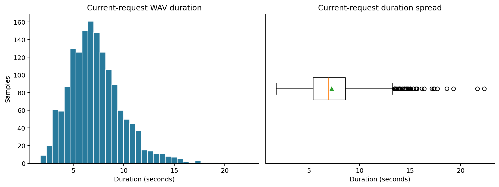

Referenced training current requests; WAV frame count / sample rate. Box shows median and interquartile range; dots are Tukey outliers. Source observations: 1,545.

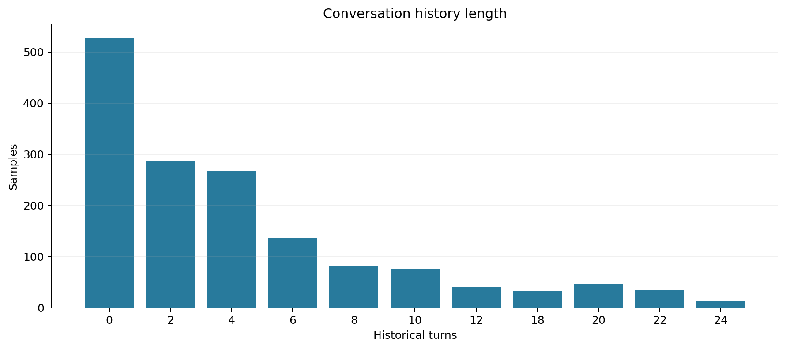

Counts of all historical user and assistant turns per training sample. Source observations: 1,545.

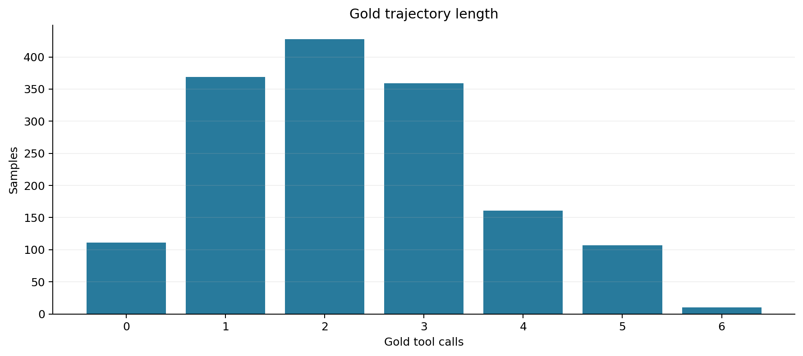

Final-request gold calls only; historical calls are excluded. Source observations: 1,545.

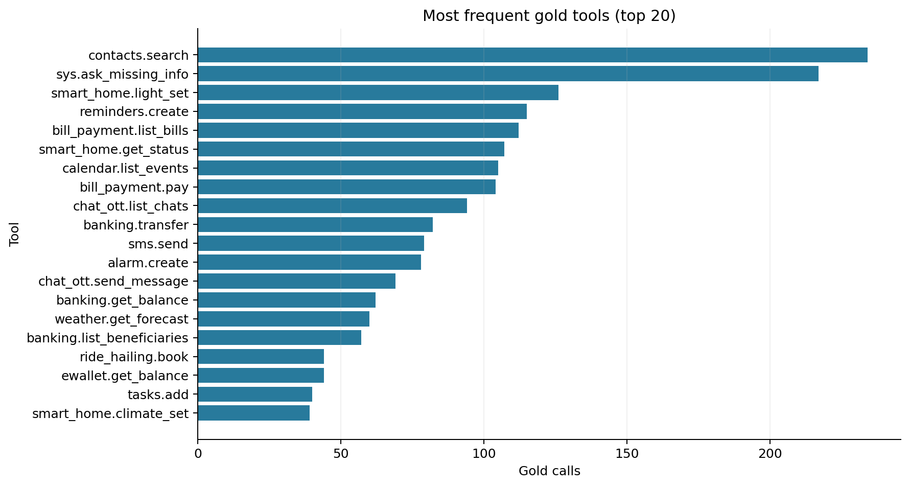

Counts of tool occurrences, including repeated calls within a sample. Source observations: 1,868.

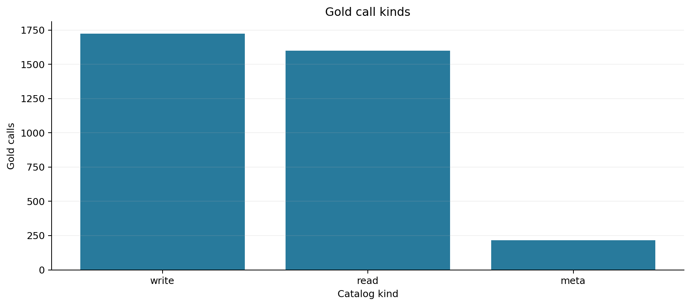

Read/write/meta labels are taken from the tool catalog; all gold calls included. Source observations: 3,541.

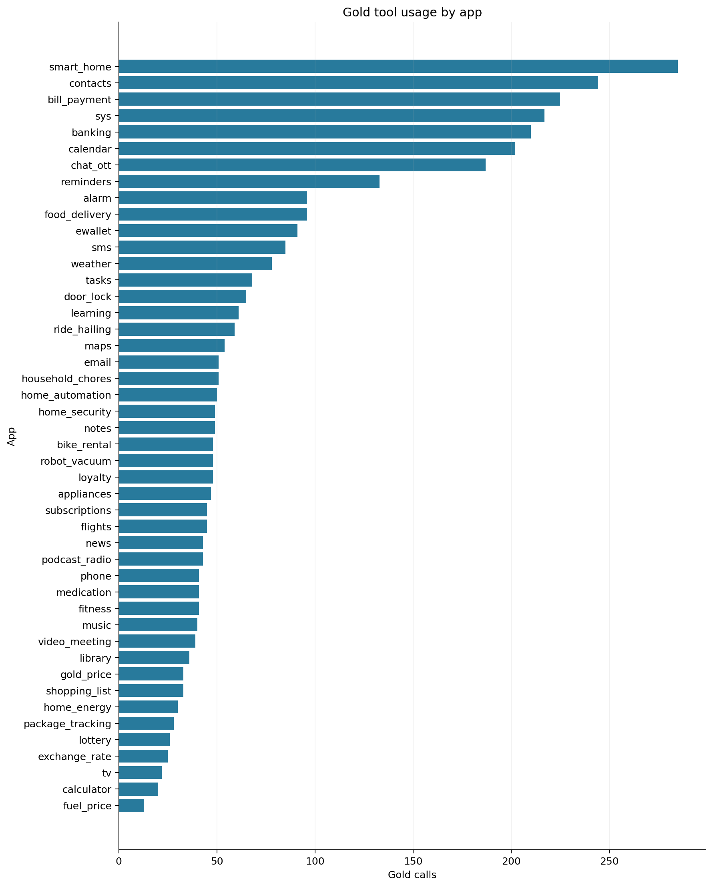

App of every gold call; a multi-app sample contributes to multiple apps. Source observations: 3,541.

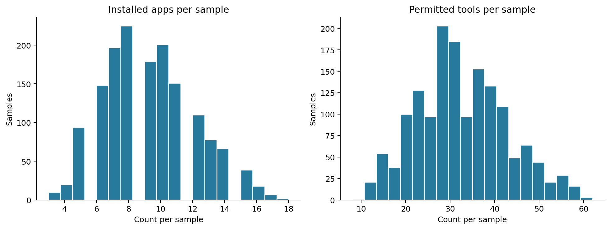

Counts from context.installed_apps; tools are the explicit permitted subset, not the entire catalog. Source observations: 1,545.

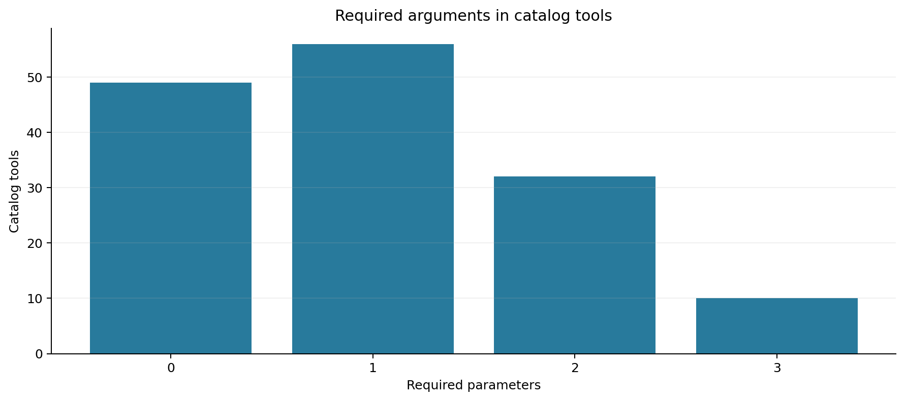

Top-level JSON Schema required list; x-one-of alternatives are counted separately in schema tables. Source observations: 147.

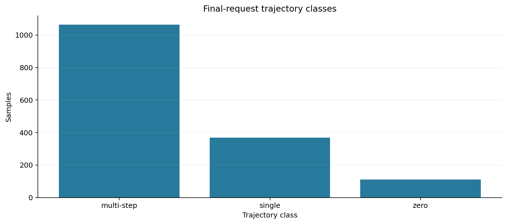

Zero = 0 calls, single = 1 call, multi-step = at least 2 calls. Source observations: 1,545.

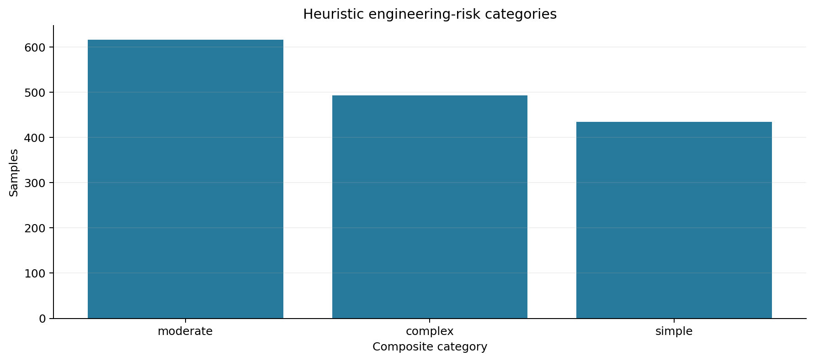

Fixed additive risk index: simple 0–2, moderate 3–5, complex 6–11. This is not measured model difficulty. Source observations: 1,545.

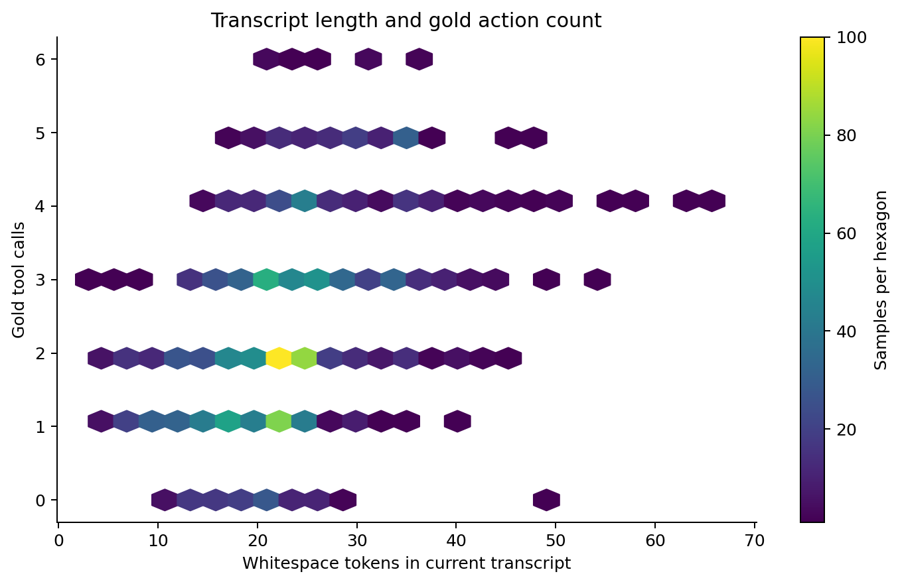

Whitespace tokens are not Vietnamese lexical word counts. All training samples are included. Source observations: 1,545.

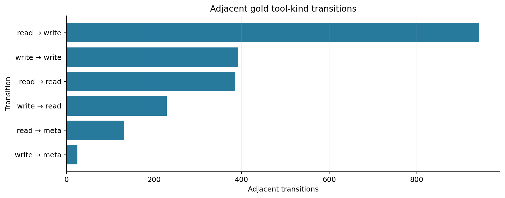

Each trajectory contributes L−1 adjacent transitions; read→write alone does not prove dependency. Source observations: 2,107.

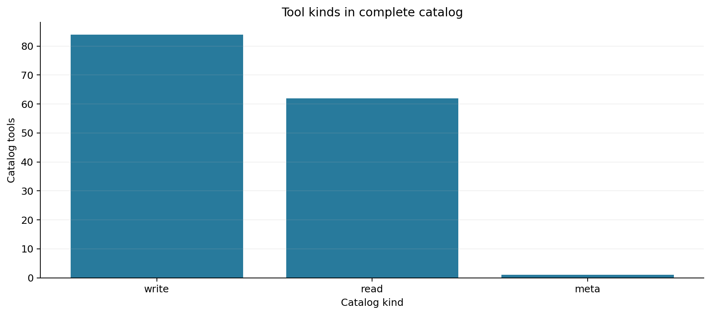

Complete training catalog, irrespective of per-sample availability or gold usage. Source observations: 147.

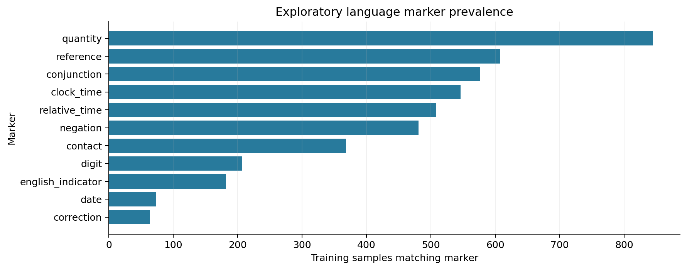

Regex dictionaries overlap. These are indicators, with false positives and false negatives, not annotated intent classes. Source observations: 4,459.

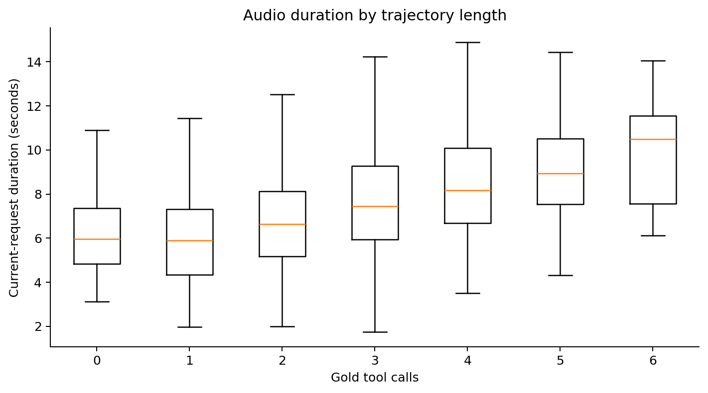

Duration distributions by final-request action count; outlier points hidden, all measurements retained in statistics. Source observations: 1,545.

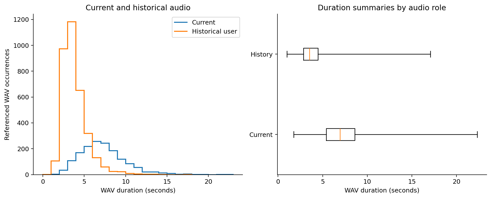

One-second histogram bins, reference-weighted by role. Boxes show quartiles/median; whiskers span observed minimum–maximum (not Tukey fences). Source observations: 5,036.
